  

  
  
  
  
  
  
  

<h1 align="center">📑 Awesome PDF Viewers &amp; Readers (2026)</h1>

  <strong>A curated collection of lightning-fast PDF readers, browser-native rendering engines, academic document viewers, self-hosted suites, and commercial SaaS platforms.</strong> 
  <em>Explore open-source alternatives to Adobe Acrobat, lightweight desktop readers, and embeddable JavaScript/React PDF libraries.</em>

---

## 🧭 Table of Contents

- [🎯 Overview &amp; Key Features](#-overview--key-features)
- [📊 Sector Overview &amp; Market Dynamics](#-sector-overview--market-dynamics)
- [☁️ SaaS &amp; Commercial Hosted Platforms](#️-saas--commercial-hosted-platforms)
- [🚀 Open-Source GitHub Projects (Ranked by Stars)](#-open-source-github-projects-ranked-by-stars)
- [🛠️ Architectural Stacks &amp; Framework Guide](#️-architectural-stacks--framework-guide)
- [🤝 How to Contribute](#-how-to-contribute)
- [📈 Star History](#-star-history)
- [💖 Support &amp; Community](#-support--community)
- [⚖️ Disclaimer &amp; License](#️-disclaimer--license)

---

## 🎯 Overview &amp; Key Features

Portable Document Format (**PDF**) remains the planetary benchmark for fixed-layout digital documents. However, conventional readers have become infamous for bloatware, aggressive background telemetry, sluggish cold starts, and steep monthly subscriptions. 

This repository provides an authoritative, SEO-indexed directory for developers, researchers, and everyday readers seeking:
- ⚡ **Sub-second launch speeds** with minimal memory footprints on Windows, Linux, and macOS.
- 🌐 **Plugin-free, browser-native rendering** using HTML5 Canvas, SVG, and WebAssembly.
- 🔬 **Specialized academic workflows** (bi-directional LaTeX SyncTeX jumping, theorem/figure previews).
- 🔒 **Privacy-respecting local &amp; self-hosted document utilities** with zero third-party telemetry.
- 🖋️ **Annotation and markup workflows** supporting stylus pressure, geometrical stamps, and form filling.

---

## 📊 Sector Overview & Market Dynamics

The global PDF, document capture, and digital document workflow software market was valued at **$4.85 billion in 2024** and is projected to expand to **$11.35 billion by 2031**, progressing at a compound annual growth rate (**CAGR of 15.2%**). Growth is propelled by hybrid enterprise digitization, regulatory compliance standards, electronic signatures, and automated AI document parsing.

### 🌐 Market Concentration & Dynamics

- **Commercial &amp; Enterprise SaaS Tier (Highly Concentrated / Winner-Take-Most)**:  
  At the enterprise and corporate contract level, the ecosystem is heavily concentrated. **Adobe Inc.** commands an estimated **70%+ market share**, capitalizing on its entrenched proprietary document ecosystem, standardized e-signature compliance (Acrobat Sign), and deep Creative Cloud integrations. A small ring of established competitors including **Foxit Software**, **Nitro Software**, and **Google Workspace** capture the majority of remaining commercial seats. High switching costs and strict enterprise security governance create substantial moats around incumbent SaaS vendors.

- **Desktop Readers, Developer Libraries &amp; Self-Hosted Tier (Moderately to Highly Fragmented)**:  
  Conversely, the developer, academic, and consumer desktop spaces are intensely fragmented. Web applications overwhelmingly standardize on Mozilla's open-source **`PDF.js`**, bypassing commercial SDK licensing. Power users and developers on Linux and Windows disproportionately gravitate toward ultra-lean standalone binaries like **`SumatraPDF`**, **`Okular`**, and **`Zathura`**, while privacy-focused self-hosters rely on community sensations like **`Stirling-PDF`**. This bifurcation reflects user resistance to SaaS subscription fatigue and a universal demand for lightweight, transparent, zero-telemetry document rendering.

---

## ☁️ SaaS & Commercial Hosted Platforms

Below is an exhaustive comparison of leading commercial PDF SaaS platforms and cloud document suites, **sorted in descending order by parent company valuation and annual revenue**.

| 🏢 Platform | 💰 Company Valuation / Revenue | 🏷️ Starting Tier Price | 🎁 Free Tier Limit / Free Trial Details | 💡 Key Strengths &amp; Best For |
| :--- | :--- | :--- | :--- | :--- |
| **[Google Drive PDF Viewer](https://drive.google.com/)** | **~$2.10 Trillion Market Cap** *(Alphabet Inc. · ~$350B+ ARR)* | **$6.00 / user / month** *(Google Workspace Starter, billed annually)* | **Free forever with 15 GB cloud storage** shared across Drive, Gmail, &amp; Photos; includes browser PDF viewing, text search, and commenting on files up to 500 MB | 🌐 **Browser-native convenience**: Zero-installation viewing, instant collaboration, and frictionless Google Cloud sharing across mobile &amp; desktop. |
| **[Adobe Acrobat Reader &amp; Pro](https://acrobat.adobe.com/)** | **~$210 Billion Market Cap** *(Adobe Inc. · ~$21.4B ARR)* | **$12.99 / month** *(Acrobat Standard, annual billed monthly)* | **Free forever for Acrobat Reader** (desktop reading, printing, basic commenting, form filling); **7-day free trial** for Acrobat Pro (full OCR, editing, unlimited e-signatures) | 🏛️ **Enterprise industry standard**: The canonical reference for complex XFA/AcroForms, prepress color profiles, and legally binding compliance. |
| **[Wondershare PDFelement](https://pdf.wondershare.com/)** | **~$1.20 Billion Market Cap** *(Wondershare · ~$210M ARR)* | **$79.99 / year** *(Individual Plan) or $129.99 perpetual* | **Free plan forever** for reading, form filling, &amp; highlighting; Pro trial has **no time limit** but watermarks saved documents and limits OCR and conversions to 3 pages | 🎨 **Balanced desktop alternative**: Robust cross-platform editing, OCR page recognition, and batch conversions without Adobe's recurring monthly cost. |
| **[Foxit PDF Reader &amp; Editor](https://www.foxit.com/)** | **~$500 Million Valuation** *(Foxit Software · ~$95M ARR)* | **$12.50 / month** *($149.99 / year for PDF Editor Suite)* | **Free forever for Foxit PDF Reader** (fast viewing, text annotations, form completion); **14-day free trial** for PDF Editor Suite (full editing, AI assistant, 1 user license) | ⚡ **High-speed enterprise alternative**: Snappy rendering, rich annotation tools, and enterprise deployment options with a fraction of Adobe's memory overhead. |
| **[Smallpdf](https://smallpdf.com/)** | **~$200 Million Valuation** *(Smallpdf GmbH · ~$32M ARR)* | **$9.00 / user / month** *(Pro Plan, billed annually at $108/yr)* | **Free forever plan** with access to 2 document operations/day; **7-day free trial** for Pro plan with unlimited desktop and cloud file viewing, compression, and signing | ☁️ **Cloud conversion utility**: Fast browser-based document conversions, quick annotations, and lightweight electronic signatures on any device. |
| **[PDFgear](https://www.pdfgear.com/)** | **~$10 Million Valuation** *(Bootstrapped Startup)* | **$0.00 / month** *(Free desktop/web app; enterprise on request)* | **100% free forever** with no daily task caps, no file size barriers, no watermarks, unlimited conversions, and free integrated ChatGPT-driven document analysis | 🆓 **Zero-cost powerhouse**: Completely free standalone reader &amp; editor with built-in AI summarization and page management for Windows, Mac, and iOS. |

---

## 🚀 Open-Source GitHub Projects (Ranked by Stars)

Every repository below is an active open-source project, **ranked strictly by GitHub Stars_Count in descending order**. Stars_Badges link directly to each project's stargazers community.

---

### 1. [Stirling-PDF](https://github.com/Stirling-Tools/Stirling-PDF) 
- **Primary Focus**: Self-Hosted Web PDF Viewer, Editor &amp; Utility Suite
- **License**: GPL-3.0 | **Stack**: Java, Spring Boot, Web Components, Docker
- **Overview**: The #1 open-source PDF application on GitHub. A complete self-hosted web-based application allowing you to view, split, merge, convert, watermark, redact, sign, and OCR PDFs securely in a private container without sending data to external SaaS clouds.
- **Best For**: Homelab enthusiasts, private enterprises, and privacy-conscious users seeking an all-in-one self-hosted PDF workbench.

---

### 2. [PDF.js](https://github.com/mozilla/pdf.js) 
- **Primary Focus**: Universal HTML5 &amp; JavaScript PDF Rendering Engine
- **License**: Apache-2.0 | **Stack**: JavaScript, HTML5 Canvas, WebAssembly
- **Overview**: The foundational standard for browser-native PDF parsing and rendering, built and maintained by Mozilla. It directly powers Firefox's built-in PDF viewer and offers a modular three-tier architecture (Core parser, Display renderer, and complete Viewer UI) embeddable via CDN or npm into any web app.
- **Best For**: Web developers embedding client-side document viewing without native plugins or server conversions.

---

### 3. [KOReader](https://github.com/koreader/koreader) 
- **Primary Focus**: Document &amp; Ebook Viewer for E-Ink, Mobile &amp; Desktop
- **License**: AGPL-3.0 | **Stack**: Lua, C, SDL, MuPDF engine
- **Overview**: A versatile document and ebook reading engine built for E-Ink devices (Kindle, Kobo, PocketBook), Android, and desktop Linux. Features smart multi-column text reflow, OCR dictionary lookups, page margin cropping, high-contrast dark modes, and deep Calibre library integration.
- **Best For**: Readers reading long-form technical PDFs and ebooks on e-readers, tablets, and mobile devices.

---

### 4. [SumatraPDF](https://github.com/sumatrapdfreader/sumatrapdf) 
- **Primary Focus**: Ultra-Fast, Minimalist Windows Desktop Document Reader
- **License**: AGPL-3.0 | **Stack**: C++, C, MuPDF engine, Win32 API
- **Overview**: The undisputed lightweight champion on Windows. Opens massive 1,000+ page documents almost instantaneously with near-zero memory footprint. Supports PDF, EPUB, MOBI, Comic Books (CBZ/CBR), XPS, and DjVu. Offers a zero-install portable executable with customizable hotkeys and LaTeX SyncTeX support.
- **Best For**: Windows users wanting pure, lightning-speed document reading with zero bloat or background services.

---

### 5. [react-pdf (Renderer)](https://github.com/diegomura/react-pdf) 
- **Primary Focus**: React Component-Based PDF Generation &amp; Viewing
- **License**: MIT | **Stack**: React, TypeScript, Yoga Layout, PDFKit
- **Overview**: Declarative framework allowing developers to write React components (`<Document />`, `<Page />`, `<Text />`) that render high-fidelity, printable PDF documents in both browser and Node.js environments.
- **Best For**: Generating programmatic PDF reports, invoices, and dynamic documents in modern React stacks.

---

### 6. [Xournal++](https://github.com/xournalpp/xournalpp) 
- **Primary Focus**: Handwritten Note-Taking &amp; Stylus PDF Annotation
- **License**: GPL-2.0 | **Stack**: C++, GTK+ 3, Poppler
- **Overview**: An open-source handwriting notetaking app with first-class PDF annotation. Delivers pressure-sensitive stylus support for Wacom and touch displays, geometric shape recognition, LaTeX formula rendering, layered annotation management, and clean PDF exports.
- **Best For**: Students, educators, and tablet users annotating slides, grading exams, and sketching math formulas on PDFs.

---

### 7. [react-pdf (Viewer)](https://github.com/wojtekmaj/react-pdf) 
- **Primary Focus**: React Wrapper for Seamless PDF.js Embedding
- **License**: MIT | **Stack**: React, TypeScript, PDF.js
- **Overview**: Provides lightweight React components that display PDF documents as easily as regular images. Decouples the low-level imperative PDF.js API into clean React props (`file`, `pageNumber`, `scale`, `rotate`), allowing custom UI creation.
- **Best For**: Front-end React applications needing bespoke, branded PDF viewing interfaces.

---

### 8. [Sioyek](https://github.com/ahrm/sioyek) 
- **Primary Focus**: Academic Research Paper &amp; Technical Textbook Reader
- **License**: GPL-3.0 | **Stack**: C++, Qt, MuPDF
- **Overview**: Custom-engineered for academic reading. Intelligently identifies references, equations, and figures, allowing jump previews in floating sub-windows without losing your reading location. Features bi-directional LaTeX SyncTeX integration, smart bookmarks, portal jumps, and Vim-inspired navigation.
- **Best For**: PhD candidates, computer scientists, researchers, and engineers digesting citation-heavy papers.

---

### 9. [pdfarranger](https://github.com/pdfarranger/pdfarranger) 
- **Primary Focus**: Graphical Drag-and-Drop PDF Page Manager &amp; Viewer
- **License**: GPL-3.0 | **Stack**: Python, GTK+ 3, pikepdf / PyPDF
- **Overview**: An intuitive, lightweight desktop application designed to visually display PDF page thumbnails, rearrange page sequences, split, merge, crop, rotate, and duplicate pages with quick keyboard shortcuts.
- **Best For**: Quick visual document restructuring without relying on heavy commercial suites.

---

### 10. [pdfme](https://github.com/pdfme/pdfme) 
- **Primary Focus**: Web-Based WYSIWYG Template Designer, Viewer &amp; Generator
- **License**: MIT | **Stack**: TypeScript, React, pdf-lib
- **Overview**: A modern, lightweight PDF viewer and visual template designer. Enables drag-and-drop document design, programmatic JSON-based generation, barcode rendering, and instant browser previewing.
- **Best For**: SaaS developers needing an embedded visual template editor for automated invoice and badge generation.

---

### 11. [Embed PDF Viewer](https://github.com/embedpdf/embed-pdf-viewer) 
- **Primary Focus**: Framework-Agnostic Embeddable Web PDF Viewer
- **License**: MIT | **Stack**: TypeScript, Web Components, PDF.js
- **Overview**: A plug-and-play modern PDF viewing component that easily integrates with vanilla JavaScript, Vue, React, Angular, and Svelte projects, sporting clean mobile-ready toolbars and smooth page rendering.
- **Best For**: Quick, modern UI integration across web frameworks.

---

### 12. [KillerPDF](https://github.com/SteveTheKiller/KillerPDF) 
- **Primary Focus**: Full-Featured Windows PDF 2.0 Editor &amp; Reader
- **License**: GPL-3.0 | **Stack**: C#, .NET, WPF, PDF 2.0 Engine
- **Overview**: A free and open-source desktop PDF editor and viewer for Windows. Features inline text editing, redaction, OCR, document comparison, form filling, and digital signing without recurring fees or cloud subscriptions.
- **Best For**: Windows power users looking for a direct open-source competitor to Acrobat Pro.

---

### 13. [Zathura](https://github.com/pwmt/zathura) 
- **Primary Focus**: Keyboard-Driven Minimalist Document Viewer
- **License**: zlib | **Stack**: C, GTK+ 3, Plugin architecture (Poppler / MuPDF)
- **Overview**: The gold standard for terminal enthusiasts and window manager power users. Features strict Vim keybindings (`j`, `k`, `/`), modular rendering backends (Poppler, MuPDF, DjVu, PostScript), automatic file reloading on compilation, and deep SyncTeX LaTeX synchronization.
- **Best For**: Linux / BSD users using i3/sway/bspwm who desire a clean, keyboard-only viewer.

---

### 14. [MuPDF](https://github.com/ArtifexSoftware/mupdf) 
- **Primary Focus**: Ultra-Fast C Rendering Core &amp; Cross-Platform CLI Viewer
- **License**: AGPL-3.0 / Commercial | **Stack**: C, WebAssembly, Python (PyMuPDF)
- **Overview**: Artifex's high-performance graphic rendering engine. Renders anti-aliased graphics with extreme fidelity, handling transparency, encryption, and interactive forms. Bundles `mutool` for rendering, page extraction, repairs, and redactions.
- **Best For**: System engineers needing an embedded C/WASM/Python PDF engine and developers processing high-throughput documents.

---

### 15. [react-pdf-viewer](https://github.com/react-pdf-viewer/react-pdf-viewer) 
- **Primary Focus**: Modular React PDF Viewer Component Suite
- **License**: Commercial / Open-Core | **Stack**: TypeScript, React, PDF.js
- **Overview**: A production-grade React viewer with a plug-and-play plugin architecture. Provides out-of-the-box plugins for bookmarks, thumbnails, search, zoom, full screen, printing, dark mode, and open/save dialogs.
- **Best For**: Complex enterprise web portals requiring an extensible React document viewer.

---

### 16. [Pympress](https://github.com/Cimbali/pympress) 
- **Primary Focus**: Dual-Screen PDF Presentation Reader (LaTeX Beamer)
- **License**: GPL-2.0 | **Stack**: Python, GTK+ 3, Poppler
- **Overview**: Specifically built for presenters using LaTeX Beamer or LibreOffice PDF slides. Displays the presentation slides on a secondary projector screen while displaying current slide, upcoming slide preview, speaker notes, and elapsed presentation timers on the presenter's laptop monitor.
- **Best For**: Academic lecturers, conference speakers, and presenters using dual-display configurations.

---

### 17. [Okular](https://github.com/KDE/okular) 
- **Primary Focus**: Universal Multi-Format Document Viewer &amp; Annotation Suite
- **License**: GPL-2.0 | **Stack**: C++, Qt, KDE Frameworks, Poppler
- **Overview**: KDE’s flagship universal document viewer. Supports PDF, EPUB, DjVu, CHM, Markdown, and TIFF. Packed with annotation tools (highlights, text callouts, stamps, freehand drawing, typewriter input), text-to-speech reading, form execution, and digital certificate verification. Available on Linux, Windows, and macOS.
- **Best For**: Cross-platform users who want enterprise-grade annotation capabilities without tracking or ads.

---

### 18. [Evince](https://github.com/GNOME/evince) 
- **Primary Focus**: Default Clean Document Reader for the GNOME Desktop
- **License**: GPL-2.0 | **Stack**: C, GTK+ 3, Poppler
- **Overview**: The streamlined standard document reader bundled across major Linux distributions (Ubuntu, Fedora, Debian). Focuses on simplicity, fast page rendering, continuous scrolling, table of contents navigation, and seamless desktop theme integration.
- **Best For**: Everyday document reading on GNOME-based Linux distributions.

---

### 19. [qpdfview](https://github.com/bendikro/qpdfview) 
- **Primary Focus**: Tabbed Lightweight Document Viewer
- **License**: GPL-2.0 | **Stack**: C++, Qt, Poppler
- **Overview**: A no-nonsense Qt-based tabbed document reader. Remembers per-file scroll positions and zoom levels, offers SyncTeX support, presentation modes, and multi-page layouts with minimal resource consumption.
- **Best For**: Qt desktop environments (LXQt, KDE) and multi-document tabbed reading workflows.

---

## 🛠️ Architectural Stacks & Framework Guide

Choosing the ideal viewer depends heavily on your runtime environment and workload:

| Category | Recommended Solution | Rationale &amp; Engine Stack |
| :--- | :--- | :--- |
| **🚀 Fastest Windows Desktop** | **SumatraPDF** | Direct Win32 rendering on top of MuPDF; cold starts in &lt;100ms. |
| **🐧 Best Linux Terminal / Tiling WM** | **Zathura** | Vim keybindings, Poppler/MuPDF plugin backend, zero visual clutter. |
| **🌐 Web Application Embedding** | **PDF.js / react-pdf** | 100% JavaScript/HTML5 Canvas, zero external native binaries or plugins. |
| **🔬 Academic Papers &amp; Math** | **Sioyek** | Reference hopping, embedded citation previews, dual-screen SyncTeX. |
| **✍️ Stylus &amp; Handwritten Notes** | **Xournal++** | Pressure-sensitive inking, GTK+ stylus input, vector shape recognition. |
| **🔒 Enterprise / Self-Hosted Privacy** | **Stirling-PDF** | Full Dockerized utility stack for internal corporate network deployments. |

---

## 🤝 How to Contribute

We welcome community suggestions, updated performance benchmarks, and new open-source discoveries!

1. 🍴 **Fork the Repository** to your GitHub account.
2. 🌿 **Create a Feature Branch** (`git checkout -b feature/add-new-pdf-viewer`).
3. 📝 **Edit `README.md`**: Follow the established table or ranking structure with accurate license info, specific pricing, and Stars_Count badges.
4. 🧪 **Verify Links**: Ensure all documentation and repository URLs point to official sources.
5. 🚀 **Submit a Pull Request** with a concise description of your changes.

---

## 📈 Star History

---

## 💖 Support & Community

Thank you for exploring **Awesome PDF Viewers**! If you find this curated collection useful for your daily reading workflows or developer integrations, please consider supporting the project:

- ⭐ **Star this repository** to help others discover fast, privacy-first PDF readers.
- 🍴 **Fork and contribute** by submitting PRs for new open-source viewers or updated benchmarks.
- 📢 **Share with fellow engineers, researchers, and students** looking for bloat-free alternatives.
- ☕ **Buy a coffee & sponsor ongoing curation**: Visit the [GitHub Sponsor Dashboard](https://github.com/sponsors/ishandutta2007) to support maintenance and community research.

  

---

## ⚖️ Disclaimer & License

- **Disclaimer**: This is an independent, community-curated directory. Product names, logos, and trademarks belong to their respective owners. Software pricing, feature tiers, and licensing terms are subject to change by their maintainers.
- **License**: Released under the [Creative Commons Zero v1.0 Universal (CC0 1.0)](https://creativecommons.org/publicdomain/zero/1.0/) Public Domain Dedication.
